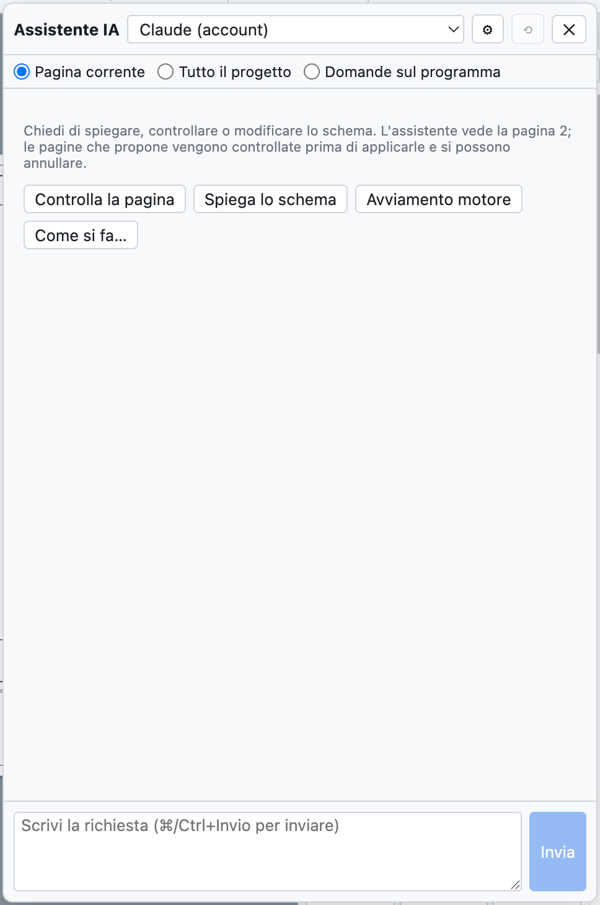
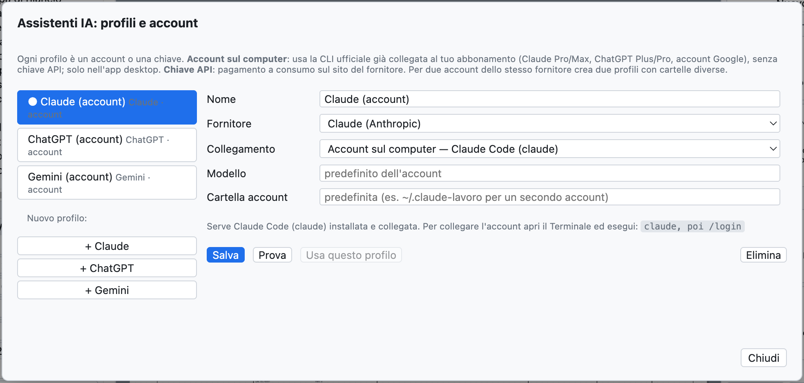
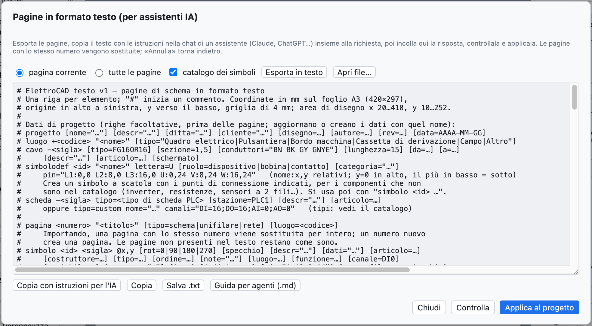

# 17. ИИ-ассистент

ИИ-ассистент — это «коллега», которого можно попросить на итальянском **объяснить**, **проверить** или
**нарисовать** части схемы. Он работает с **Claude** (Anthropic), **ChatGPT** (OpenAI) и **Gemini**
(Google) через ваши учётные записи.



*Панель ассистента с кнопками быстрых запросов.*

## Открыть ассистента

*Проект ▸ ИИ-ассистент…* или **⌘I** открывает панель справа; схема остаётся видимой, и можно
работать, пока ассистент отвечает.

Вверху выбираются:

- **профиль**: какой ассистент и какая учётная запись;
- **контекст**: что видит ассистент.

| Контекст | Что получает ассистент |
|---|---|
| *Текущая страница* | страницу в текстовом формате, руководство по формату с каталогом символов, проблемы проверки на этой странице |
| *Весь проект* | все страницы, данные проекта (места установки, кабели, модули ПЛК) и все проблемы проверки |
| *Вопросы о программе* | руководство OpenWiring, для вопросов о меню и командах |

## О чём можно просить

| Запрос | Пример |
|---|---|
| Объяснить | «Объясни, как работает цепь на этой странице» |
| Проверить | «Проверь эту страницу: соединения, обозначения, защиты, стандарт CEI EN 60204-1» |
| Нарисовать | «Добавь страницу 7 с пуском звезда-треугольник для двигателя 15 кВт» |
| Изменить | «Добавь сигнальную лампу неисправности, управляемую контактом 95-96 теплового реле» |
| Работа с программой | «Как создать двухъярусный клеммник?» |

Кнопки быстрых запросов *Проверить страницу*, *Объяснить схему*, *Пуск двигателя*, *Как сделать…* отправляют
готовые запросы. **⌘Enter** отправляет, *Отмена* прерывает длинный ответ, ⟲ начинает новый разговор.

## Когда ассистент рисует

Если ответ содержит страницы в текстовом формате, панель **сразу проверяет** их:

- *Готово: добавляет страницу 7 · проблем нет* → нажмите **Применить к проекту**;
- если есть ошибки или проблемы проверки, они показываются под ответом: **Попросить исправить**
  отправляет ассистенту ошибки и проблемы, и он исправляет.

Применение отменяется клавишами **⌘Z**. Страница с тем же номером, что и существующая, заменяет её;
новый номер добавляет страницу.

> **Реальный пример.** На запрос «Добавь новую страницу (номер 7) с прямым пуском трёхфазного двигателя
> 4 кВт: автомат защиты двигателя, контактор, клеммник и двигатель» Claude примерно за 30 секунд ответил
> готовой страницей (автомат защиты двигателя `-7Q1`, контактор `-7K1`, клеммы `-X2`, двигатель `-7M1`, кабель `-7W1`)
> и сам отметил, что в цепи управления отсутствует катушка контактора.

## Профили и учётные записи

*Проект ▸ ИИ-ассистенты: профили и учётные записи…* (или ⚙ в панели).



*По одному профилю на каждого ассистента: при первом использовании есть по одному для Claude, ChatGPT и Gemini.*

У каждого профиля есть имя, поставщик, способ подключения и модель. Можно иметь несколько профилей
одного поставщика, например личную и корпоративную учётную запись.

### Учётная запись на компьютере (подписка)

В настольном приложении профиль может использовать **официальный CLI** поставщика, уже подключённый к вашей подписке:
ключ API не нужен, используется квота подписки.

| Поставщик | Устанавливаемая программа | Подписка | Команда для подключения учётной записи |
|---|---|---|---|
| Claude | Claude Code (`claude`) | Claude Pro или Max | `claude`, затем `/login` |
| ChatGPT | Codex CLI (`codex`) | ChatGPT Plus или Pro | `codex login` |
| Gemini | Gemini CLI (`gemini`) | учётная запись Google | `gemini`, затем *Login with Google* |

Команда выполняется один раз в Терминале. Для **второй учётной записи** того же поставщика укажите в
профиле другую **папку учётной записи** (например `~/.claude-lavoro`): окно покажет точную
команду, например `CLAUDE_CONFIG_DIR=~/.claude-lavoro claude`.

Если срок доступа истёк, ассистент отвечает командой, которую нужно выполнить (например `codex login`).

### Ключ API

При подключении через *Ключ API* оплата ведётся по расходу на сайте поставщика:

| Поставщик | Где создаётся ключ |
|---|---|
| Claude | console.anthropic.com |
| ChatGPT | platform.openai.com |
| Gemini | aistudio.google.com |

Вставьте ключ в профиль; *Перечислить* показывает модели, доступные с этим ключом. В настольном приложении
ключ **шифруется** операционной системой и хранится только на этом компьютере.

**Проверка** проверяет подключение коротким вопросом; **Использовать этот профиль** делает его активным.

## Перевод словаря

*Проект ▸ Перевести с помощью ИИ-ассистента* (или *Перевести с помощью ИИ* на вкладке «Переводы») отправляет активному ассистенту
тексты проекта без перевода и переведённые слово за словом и запрашивает английский и немецкий
с отраслевой терминологией. Переводы попадают в словарь как **требующие проверки** (см.
[главу 16](16-lingue.md)).

## Текстовый формат с внешним ассистентом

Можно работать и с ассистентом в чате браузера, без профилей:



*Окно страниц в текстовом формате.*

1. *Файл ▸ Страницы в виде текста (ИИ-ассистенты)…*: выберите *текущая страница* или *все страницы* и нажмите
   **Экспорт в текст**.
2. **Копировать с инструкциями для ИИ** и вставьте в чат, дописав запрос в конце.
3. Вставьте ответ в окно (можно вместе с окружающим текстом), нажмите **Проверить**, а затем
   **Применить к проекту**.

Формат — одна строка на элемент:

```text
luogo +Q1 "Quadro elettrico"
pagina 7 "Ventilazione quadro" luogo=Q1
  simbolo potential +24V @28,24
  filo 28,24 400,24
  simbolo potential 0V @28,232
  filo 28,232 400,232
  simbolo pb_no -? @100,60 descr="Marcia ventilatore"     # "-?" = sigla automatica
  simbolo coil -7K1 @100,140 descr="Contattore ventilatore"
  collega -7S1:13 100,24                                  # verso la barra +24V
  collega -7S1:14 -7K1:A1                                 # per sigla e punto di connessione
  collega -7K1:A2 100,232
```

Полный синтаксис приведён в **руководстве для агентов** (*Справка ▸ Руководство для ИИ-агентов (.md)…*), см.
[главу 19](19-riga-di-comando.md).

## Конфиденциальность

Схема, отправленная ассистенту, покидает компьютер и попадает к выбранному поставщику, на условиях
его использования. При выборе *Текущая страница* отправляется только открытая страница.
