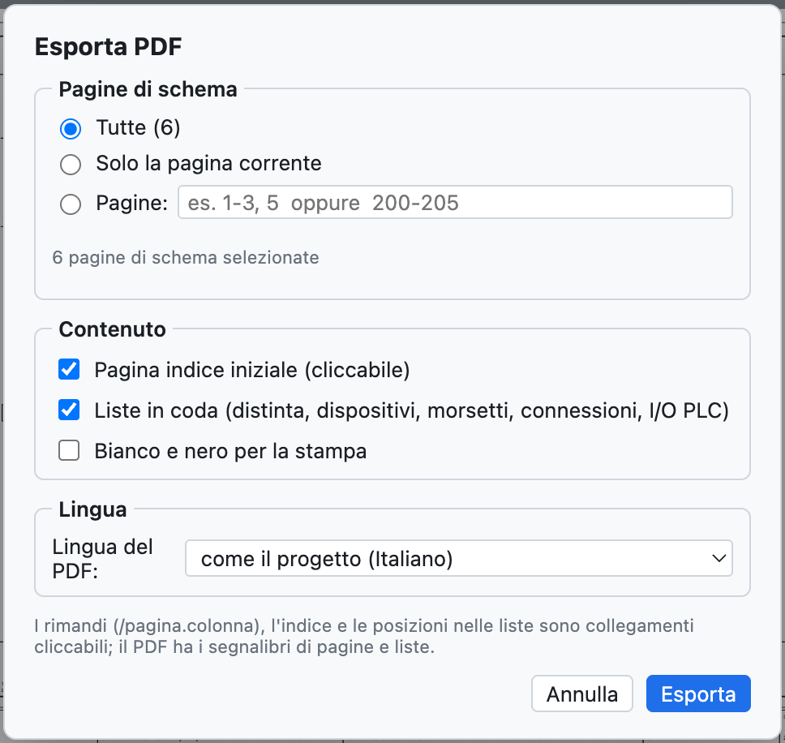
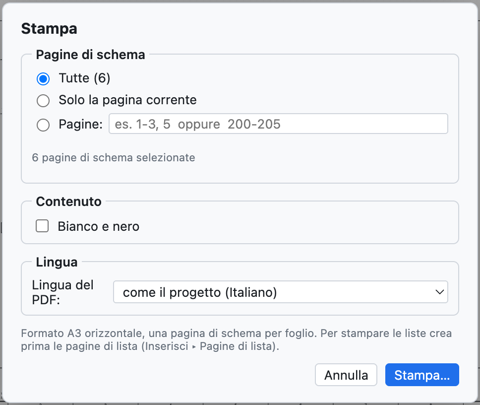

# 18. Импорт и экспорт

## PDF

**PDF** на панели инструментов (или *Файл ▸ Экспорт ▸ PDF…*) создаёт векторный PDF формата A3.

*Параметры PDF.*

| Параметр | Эффект |
|---|---|
| *Все*, *Только текущая страница*, *Страницы* | какие страницы; диапазон задаётся номерами проекта (`1-3, 5` или `200-205`) |
| *Начальная страница-оглавление* | кликабельное оглавление страниц и списков |
| *Списки в конце* | спецификация, устройства, клеммы, соединения, ввод-вывод ПЛК после схем |
| *Чёрно-белый для печати* | провода и номера проводов чёрным |
| *Язык PDF*, *Второй язык* | PDF на другом языке без изменения проекта |

В PDF **межстраничные связи кликабельны** (контакты ↔ катушка, связи между страницами, ПЛК, обзоры), так же как
позиции в списках и оглавление; в PDF есть **закладки** страниц и списков.

## Печать

*Файл ▸ Печать…* (⌘P) отправляет страницы на принтер в **горизонтальном формате A3**, одна страница на лист.

*Параметры печати: страницы, чёрно-белый режим, язык.*

Чтобы печатать и списки, сначала создайте страницы списков ([глава 14](14-liste-e-pagine-automatiche.md#автоматические-страницы)).

## DXF

| Команда | Результат |
|---|---|
| *Файл ▸ Экспорт ▸ DXF текущей страницы* | один DXF R12 в масштабе 1:1, в мм |
| *Файл ▸ Экспорт ▸ DXF всего проекта (ZIP)* | по одному DXF на страницу, собранные в архив ZIP |
| на странице компоновки | DXF сверления монтажной платы ([глава 12](12-layout-quadro.md#сверление)) |

В DXF есть слои CORNICE, CARTIGLIO, SIMBOLI, FILI, TESTI, SIGLE, NUMERI_FILO (а также CAVI и QUADRI, где нужно), и они
открываются в AutoCAD, DraftSight, LibreCAD и других САПР. Формат DWG недоступен:
откройте DXF и сохраните в DWG из САПР.

## Excel и CSV

- Каждый список экспортируется в **CSV** (разделитель `;`) из вида «Списки».
- **Навигатор устройств** экспортирует и повторно импортирует Excel ([глава 7](07-dispositivi-e-articoli.md#excel)).
- Вид **ПЛК** экспортирует для TIA Portal, CODESYS, PLCopen и список ввода-вывода ([глава 10](10-plc.md)).
- **Этикетки** выводятся в Excel или CSV ([глава 14](14-liste-e-pagine-automatiche.md#этикетки-для-маркировки)).
- **Словарь** переводов выводится в CSV ([глава 16](16-lingue.md)).

## Импорт схем из PDF (SEE Electrical и другие)

*Файл ▸ Импорт ▸ Схема из PDF (SEE Electrical…)…* создаёт **новый проект** из схемы, экспортированной в
**векторный PDF** другой САПР. Функция проверена на реальном проекте SEE Electrical из 207 страниц,
импортированном за несколько секунд.

Что восстанавливается:

- **листы**: по одному на каждый лист схемы, с номером и заголовком из основной надписи; префикс заголовка
  (`Q1.1 Ingresso linea`) становится местом установки `+Q1.1`; титульный лист и списки исходной САПР пропускаются;
- **настоящие провода** с цветом из чертежа (синий → BU, жёлто-зелёный → PE, красный → RD…) и подписанным рядом именем
  (`L1-1.1`, `200.01`) в качестве номера провода;
- **компоненты** с ближайшим **обозначением**, **клеммы** там, где подходят провода, и их имена (`1/L1`, `A1`, `95`);
- **клеммы клеммников**, в том числе многоярусные (`X1.1.12:1A`);
- **межстраничные связи**, сопоставленные по имени или по ссылкам `лист.столбец`;
- свободные тексты и тексты компонентов.

Что стоит перепроверить: компоненты распознаются по графике и не знают, катушки они или контакты
(поэтому изображения контактов нет); некоторые элементы остаются графикой без обозначения. *Проект ▸ Проверка*
сообщает об оборванных жилах и связях без пары. Отсканированный PDF (изображение) импортировать нельзя.

## Другие виды импорта

| Команда | Что импортирует | См. |
|---|---|---|
| *Артикулы EDZ / XML / CSV…* | артикулы производителей с изображениями, клеммами, чертежом и коммерческими данными (CSV) | [глава 7](07-dispositivi-e-articoli.md#импорт-данных-производителей-edz) |
| *Символы QElectroTech…* | компоненты `.elmt`, `.qet`, архивы | [глава 13](13-macro-simboli-cartigli.md#компоненты-qelectrotech) |
| *Макросы…* | файлы `.ecmacro` | [глава 13](13-macro-simboli-cartigli.md#макросы) |
| *Сравнить с файлом .ecad…* | отличия от другого проекта | [глава 15](15-verifica-ricerca-revisioni.md#сравнение-двух-проектов) |
| *Импорт DXF…* в редакторе основных надписей | основная надпись, нарисованная в другой САПР | [глава 13](13-macro-simboli-cartigli.md#импорт-основной-надписи-из-dxf) |
| *Импорт переменных* (вид ПЛК) | таблица переменных TIA Portal, CODESYS, CSV | [глава 10](10-plc.md#импорт-переменных) |
| *Страницы в виде текста* | страницы, написанные ИИ-ассистентом или скриптом | [глава 17](17-assistente-ia.md#текстовый-формат-с-внешним-ассистентом) |

## Другие виды экспорта

| Команда | Результат |
|---|---|
| *PLCopen XML (переменные ПЛК)* | глобальные переменные для CODESYS и совместимых сред |
| *Артикулы в XML (формат EPLAN)* | артикулы библиотеки в файле XML в формате EPLAN |
| *Словарь переводов (CSV)* | таблица `Italiano;English;Deutsch` |
